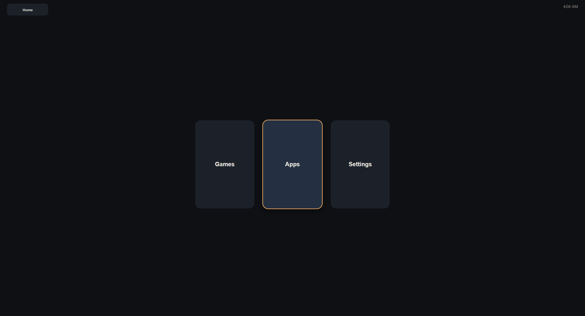
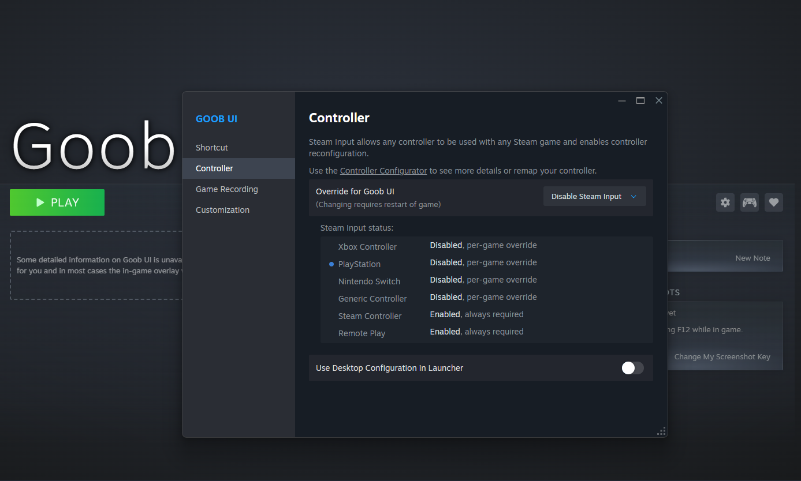
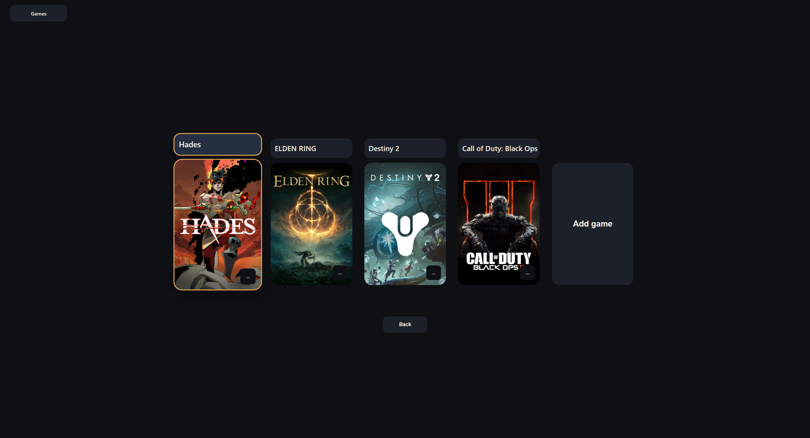
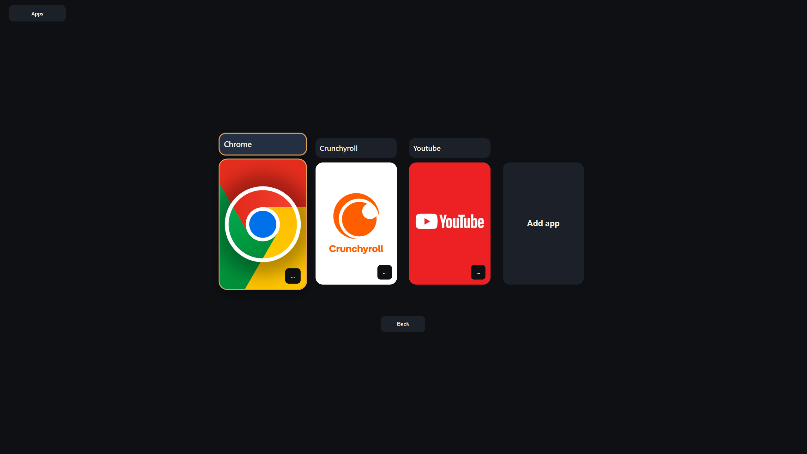

#  Goob UI 

**Version 1.1.2

A modern, controller-first desktop interface built with **Tauri + React + TypeScript**.

Launch Steam games and local apps, navigate with a controller, and run fullscreen like a console.

### Goob UI Home Screen



## Installation

Download the latest release from the [Releases page](https://github.com/cgwol/react_g_gui/releases).

- **Windows**: Download and run the `.exe` installer
- **macOS**: Download the `.dmg`, open it, and drag the app to Applications

## Steam Setup to avoid double input in Goob UI

- In the Steam library add Goob UI as a Non-Steam Game
- Once Goob UI is added to the steam library, go to manage, then to properties
- In the controller tab, in Override for Goob UI, Disable Steam Input
- Restart Goob UI



## How to Use the App

1. Launch Goob UI.
2. Use a controller (recommended) or keyboard to navigate the home screen tiles:
   - **Games** — your Steam and local game library
   - **Apps** — local applications
   - **Settings** — themes, window mode, sensitivity, etc.
3. Select a tile to launch it.
4. Press the Options / Start / Escape button (depending on input) to open the side menu.
5. Use the back button (Circle / B / Backspace) to return to the previous screen.

Controller legends adapt to PlayStation, Xbox, or Nintendo layouts (or auto-detect).

## How to Install Games

### Steam Games
1. Go to the **Games** page.
2. Select **Add game** → **Add Steam game**.
3. Choose a game from your local Steam library.
4. Some Steam Games don't have a game image, this can be set manually later.

**Recommended Steam settings for best results:**
- Enable steam to launch when computer starts
- In Steam → Settings → Controller, make sure your controller is detected 
- Prefer games that support native controller input (or have good community controller configs).
- For the cleanest experience with Goob UI’s window modes, run Steam and games in **borderless windowed** or **fullscreen** rather than exclusive fullscreen when the launcher needs to stay in control of focus/windowing.
- Keep Steam running in the background so library scanning and launching work reliably.
- In Steams Controller Advanced Settings, disable:
1. Guide Button focuses Steam
2. Turn off Controlles when exiting Big Picture Mode
3. Enable Guide Button Chords for Controllers

### Local / Non-Steam Games
1. Go to the **Games** page.
2. Select **Add game** → **Add other game**.
3. Pick an `.exe` (or equivalent) file.
4. Rename the tile and optionally set a custom image.

Games are sorted by last played. You can rename, change the tile image, or delete entries from the tile menu (Triangle / Y / K).

### Goob UI Games Page 

## How to Install Apps

1. Go to the **Apps** page.
2. Select **Add app**.
3. Choose an `.exe` or `.bat` file.
4. Rename the tile and optionally set a custom image.

Apps work the same way as local games (launch, rename, set image, delete, last-played sort).

## Best Settings for Media Apps

Media apps and streaming sites (YouTube, Netflix, Disney+, etc.) work best as dedicated Chrome “app” launches with controller support and (optional) automatic cursor hiding.

### Recommended Setup

1. Create a dedicated Chrome profile for each service (keeps logins and settings separate).
2. Use a ```.bat``` launcher that: 
     - Starts Chrome in app/fullscreen mode with that profile
     - Launches an AutoHotkey script to hide the mouse cursor (optional)
     - Cleans up when the window closes

### Option 1 for browser/app controller supprot
3. Using a Steam Desktop Non-Game Controller Layout
     - In steam controller settings, enter the advanced settings
     - For best results, in external Gamepad Settings, disable all settings except your controller Support
     - In the Non-Game Controller Layout, press edit. Enable Steam Input translation
     - Use default layout or create a custom layout for your controller

### Option 2 for browser controller support

3. Install the [Couch Controller Chrome extension](https://chromewebstore.google.com/detail/odlaphcdndfenefjhmoneehgjbcpkhof?utm_source=item-share-cb) in that profile so you can navigate the site with a gamepad. (Other Controller extenstions should work)

### First-Time Setup (per media app)

1. Run a setup batch file that opens the correct Chrome profile and login into the media site:
```
@echo off
set CHROME="C:\Program Files\Google\Chrome\Application\chrome.exe"
if not exist %CHROME% set CHROME="C:\Program Files (x86)\Google\Chrome\Application\chrome.exe"

::Edit the name of the folder to be created per media site
set PROFILE=%LOCALAPPDATA%\GoobMedia\Youtube
if not exist "%PROFILE%" mkdir "%PROFILE%"

:: Delete link to couch controller if using option 1
%CHROME% --user-data-dir="%PROFILE%" --no-first-run --disable-session-crashed-bubble --new-window https://chromewebstore.google.com/detail/couch-controller/odlaphcdndfenefjhmoneehgjbcpkhof
```
2. Sign in to the streaming service and install/enable Couch Controller.
3. Close the window.

### Launch Batch File Example

1. Create a ```.bat``` launcher 
```
@echo off

set CHROME="C:\Program Files\Google\Chrome\Application\chrome.exe"
if not exist %CHROME% set CHROME="C:\Program Files (x86)\Google\Chrome\Application\chrome.exe"

:: Replace Youtube with desired Media Site
set PROFILE=%LOCALAPPDATA%\GoobMedia\Youtube
if not exist "%PROFILE%" mkdir "%PROFILE%"

:: Replace Youtube with desired Media Site
%CHROME% --user-data-dir="%PROFILE%" --app=https://www.youtube.com --start-fullscreen --no-first-run --disable-session-crashed-bubble --new-window
```
2. Go to the Apps page.
3. Add the launch .bat file as an app.
4. Set a custom tile image (search [SteamGridDB](https://www.steamgriddb.com/) for high-quality artwork for the service).
5. Launch it from the tile like any other app.

### Launch Batch File Example with Autohotkey for cursor hiding (Optional)

Use an AutoHotkey v1 script (```CursorHide.ahk```) that:

- Hides the system cursor when the batch starts
- Shows the cursor immediately on mouse movement
- Hides it again after ~1.5 seconds of no movement
- Restores the normal cursor and exits when the batch ends (via the lock file)

This gives a clean console-style experience while still allowing mouse use when needed.

### Autohotkey File (```CursorHide.ahk```)

```
; AutoHotkey v1 script
; Hides mouse cursor when started (by your BAT file)
; Shows cursor immediately when mouse moves
; Hides again after 1.5 seconds of no movement
; Restores normal cursor and exits when the BAT file ends (via lock file)

#NoEnv
#Persistent
#SingleInstance Force
SetBatchLines, -1

; Lock file used to detect when the BAT file has finished
LockFile := A_Temp . "\cursor_hide.lock"

; Exit and restore cursor if lock file disappears
SetTimer, CheckLock, 500

; Ensure cursor is restored on any exit
OnExit, RestoreCursor

; Initialize and hide cursor immediately
SystemCursor("Init")
SystemCursor("Off")

; Track mouse position and last movement time
CoordMode, Mouse, Screen
MouseGetPos, lastX, lastY
lastMove := A_TickCount
isHidden := true

; Check mouse movement frequently
SetTimer, CheckMouse, 50

return

CheckMouse:
    MouseGetPos, currX, currY
    if (currX != lastX || currY != lastY) {
        ; Mouse moved — show cursor and reset timer
        if (isHidden) {
            SystemCursor("On")
            isHidden := false
        }
        lastX := currX
        lastY := currY
        lastMove := A_TickCount
    } else if (!isHidden && (A_TickCount - lastMove > 1500)) {
        ; Idle for 1.5 seconds — hide again
        SystemCursor("Off")
        isHidden := true
    }
return

CheckLock:
    if (!FileExist(LockFile)) {
        ; BAT has ended — exit (OnExit will restore cursor)
        ExitApp
    }
return

RestoreCursor:
    SystemCursor("On")
    ExitApp
return

; Optional hotkey to force exit and restore (for testing)
Esc::ExitApp

; ========== SystemCursor function ==========
SystemCursor(OnOff=1)   ; INIT = "I","Init"; OFF = 0,"Off"; TOGGLE = -1,"T","Toggle"; ON = others
{
    static AndMask, XorMask, $, h_cursor
        ,c0,c1,c2,c3,c4,c5,c6,c7,c8,c9,c10,c11,c12,c13 ; system cursors
        , b1,b2,b3,b4,b5,b6,b7,b8,b9,b10,b11,b12,b13   ; blank cursors
        , h1,h2,h3,h4,h5,h6,h7,h8,h9,h10,h11,h12,h13   ; handles of default cursors
    if (OnOff = "Init" or OnOff = "I" or $ = "")       ; init when requested or at first call
    {
        $ = h                                          ; active default cursors
        VarSetCapacity( h_cursor,4444, 1 )
        VarSetCapacity( AndMask, 32*4, 0xFF )
        VarSetCapacity( XorMask, 32*4, 0 )
        system_cursors = 32512,32513,32514,32515,32516,32642,32643,32644,32645,32646,32648,32649,32650
        StringSplit c, system_cursors, `,
        Loop %c0%
        {
            h_cursor   := DllCall( "LoadCursor", "Ptr",0, "Ptr",c%A_Index% )
            h%A_Index% := DllCall( "CopyImage", "Ptr",h_cursor, "UInt",2, "Int",0, "Int",0, "UInt",0 )
            b%A_Index% := DllCall( "CreateCursor", "Ptr",0, "Int",0, "Int",0
                , "Int",32, "Int",32, "Ptr",&AndMask, "Ptr",&XorMask )
        }
    }
    if (OnOff = 0 or OnOff = "Off" or $ = "h" and (OnOff < 0 or OnOff = "Toggle" or OnOff = "T"))
        $ = b  ; use blank cursors
    else
        $ = h  ; use the saved cursors

    Loop %c0%
    {
        h_cursor := DllCall( "CopyImage", "Ptr",%$%%A_Index%, "UInt",2, "Int",0, "Int",0, "UInt",0 )
        DllCall( "SetSystemCursor", "Ptr",h_cursor, "UInt",c%A_Index% )
    }
}
```

### Launch Batch File Example with ```CursorHide.ahk```

```
@echo off

:: Create lock file so the AHK script knows the BAT is running
echo. > "%TEMP%\cursor_hide.lock"

:: Start the AutoHotkey script (adjust path if needed)
start "" "CursorHide.ahk"

set CHROME="C:\Program Files\Google\Chrome\Application\chrome.exe"
if not exist %CHROME% set CHROME="C:\Program Files (x86)\Google\Chrome\Application\chrome.exe"

:: Replace Youtube with desired Media Site
set PROFILE=%LOCALAPPDATA%\SteamMedia\Youtube
if not exist "%PROFILE%" mkdir "%PROFILE%"

:: Replace Youtube with desired Media Site
%CHROME% --user-data-dir="%PROFILE%" --app=https://www.youtube.com --start-fullscreen --no-first-run --disable-session-crashed-bubble --new-window

del "%TEMP%\cursor_hide.lock"
```

### Tips for apps
- One profile + one launch bat per streaming service works best.
- Keep Couch Controller enabled in each profile. (Or other controller extension)
- [SteamGridDB](https://www.steamgriddb.com/) is a great source for consistent, high-quality tile art for media apps.

### Goob UI Apps Page 

# Version 1.1.2 Changelog

- 

## Current Known Issues

- ~~Production builds getting game through steam can be slow. (Config file should fix this)~~
- ~~Proper Windowed Mode and Windows Fullscreen support that doesnt rely on user settings resolution~~
- ~~Cursor issues when tabbing back into app.~~ 
- Cursor appears and stays when clicking on when controller mode is on

## Features to be added in future versions

- ~~Local config file~~
- Sleep Screen
- In app/game home button support
- Games/Apps pages will show curerntly running game/apps

## How to Run the Dev Environment

### Prerequisites
- [Node.js](https://nodejs.org/) (LTS recommended)
- [Rust](https://www.rust-lang.org/tools/install) (required for Tauri)
- Windows, macOS, or Linux

### Steps
1. Clone the repository:
   ```bash
   git clone https://github.com/cgwol/react_g_gui.git
   cd react_g_gui
   ```
2. Install dependencies:
   ```bash
   npm install
   ```
3. Run in development mode:
   ```bash
   npm run dev
   ```
4. (Optional) Build a production installer:
   ```bash
   npm run tauri build
   ```
   The packaged app will be in `src-tauri/target/release/bundle/`.

- Vite serves the frontend at `http://localhost:1420`.
- The first Rust compile can take a minute; later starts are much faster.

Recommended editor setup: VS Code with the Tauri and rust-analyzer extensions.

## Tech Stack

- **Frontend**: React 19 + TypeScript + Vite
- **Desktop**: Tauri v2 (Rust backend)
- **Input**: Browser Gamepad API (DualSense and others)
- **Games**: Steam URI protocol + local executables

## License

**MIT License**


